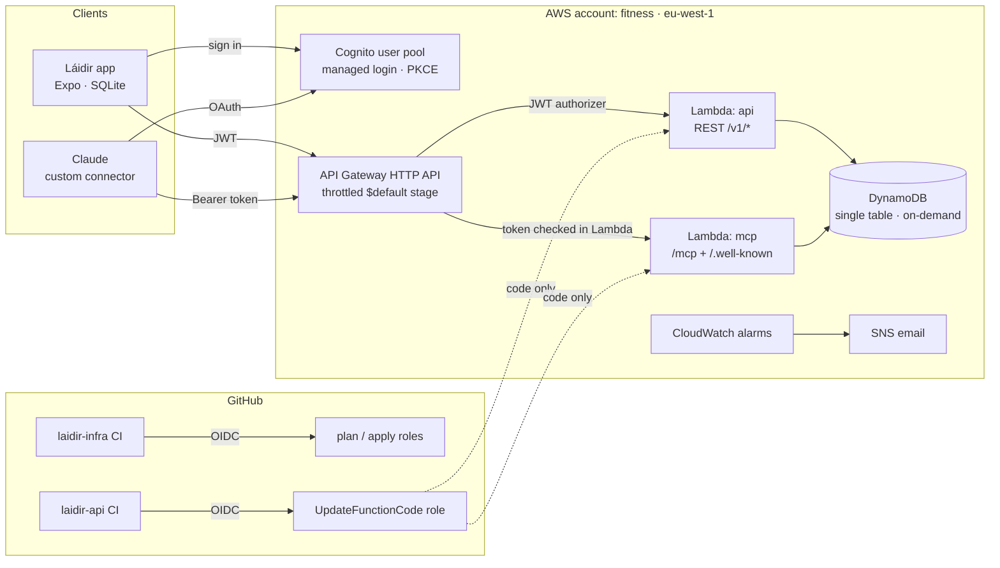

# laidir-infra

Terraform for **Láidir** (Irish for *strong*): a local-first workout tracker with a
Claude connector, so you can build a routine in chat and have it appear in the app.

This repo is one of three:

| Repo | What |
|---|---|
| **laidir-infra** (this) | AWS infrastructure: Terraform, GitHub OIDC, CI/CD |
| laidir-api | TypeScript Lambdas: REST API + MCP server, OpenAPI spec (source of truth) |
| laidir-mobile | Expo / React Native app (Android first), SQLite local-first, typed client from OpenAPI |

## Architecture



**Why `/mcp` skips the gateway's JWT authorizer:** Claude starts sign-in only when it receives a
`401` with a `WWW-Authenticate: Bearer resource_metadata=...` header. API Gateway's built-in authorizer
returns a bare 401, so the MCP Lambda validates the Cognito token itself and returns the right header.

**Why there's no NAT, ALB, RDS or VPC:** nothing here needs a network. Everything is pay-per-request,
so idle cost is ~€0.

## Repo layout

```
bootstrap/          S3 state bucket (versioned, SSE, TLS-only). Applied once, by hand.
global/             Account-wide: GitHub OIDC provider, CI roles, permissions boundary, budget. Applied by hand.
modules/            Reusable modules (one concern each).
envs/prod/          The app, composed from modules. Applied by CI on merge to main.
.github/workflows/  pr.yml (checks + plan comment), deploy.yml (apply on merge).
docs/               Access patterns and design notes.
```

Each root has its own state file in `laidir-tfstate-<account-id>`, locked with S3-native lock files
(`use_lockfile = true`, Terraform ≥ 1.11). No DynamoDB lock table.

Every provider block sets `allowed_account_ids`, so Terraform refuses to run against any account
other than the workload account, even with the wrong `AWS_PROFILE`.

## CI/CD

```
feature branch ─► PR ─► checks: fmt · validate · tflint · checkov
                    └─► plan (read-only role) ─► PR comment: summary table + full plan
merge to main ───────► re-plan + apply (apply role, GitHub Environment "prod")
```

- `main` is protected: PRs only, checks must pass, branch must be up to date.
- The plan comment is updated in place on each push, and flags destroys and replaces with a warning.
- Deploy re-plans against live state instead of reusing the PR's plan, so a stale plan can't be applied.
- Applies are serialised with a concurrency group and never cancelled mid-run.

### Security model

| Role | Trusted for (OIDC `sub`) | Can do |
|---|---|---|
| `laidir-gha-infra-plan` | `repo:EamonnHegarty@91144434/laidir-infra@1457972060:pull_request` | Read-only, plus write state lock files |
| `laidir-gha-infra-apply` | `repo:EamonnHegarty@91144434/laidir-infra@1457972060:environment:prod` | Read-only, plus writes scoped to `laidir-prod-*` |
| `laidir-gha-api-deploy-prod` | `repo:…/laidir-api@<id>:environment:prod` | `lambda:UpdateFunctionCode` on the two functions, nothing else |

GitHub issues **immutable subject claims** for these repos: owner and repo numeric IDs are part of `sub`. If a repo is
deleted and someone recreates one with the same name, it gets a new ID and can't assume these roles.
Check a repo's format with `gh api repos/<owner>/<repo>/actions/oidc/customization/sub`.

- **No long-lived keys anywhere.** Humans use IAM Identity Center (SSO); CI uses OIDC.
- **Permissions boundary.** The apply role can only create IAM roles that carry `laidir-workload-boundary`,
  and it can't modify the boundary. So CI can't escalate past it, even with a bad PR.
- **CI can't edit its own access.** `global/` (the CI roles themselves) is applied by a human only.
- **CI can't read user data.** Both roles explicitly deny DynamoDB item reads, Cognito user listing and
  log reads, even though `ReadOnlyAccess` would allow them.
- Trust conditions use `StringEquals` on exact `sub` claims (no wildcards), and forks never get a token.

### Lambda code ownership

Terraform creates each function with placeholder code and ignores code changes
(`lifecycle { ignore_changes = [filename, source_code_hash] }`). The `laidir-api` repo's CI ships code with
`aws lambda update-function-code`. Terraform owns configuration (memory, env vars, IAM); the API repo owns code.

## Cost notes (personal scale)

| Service | Free allowance (always-free unless noted) | Expected |
|---|---|---|
| Lambda | 1M requests + 400k GB-s / month | €0 |
| DynamoDB on-demand | 25 GB storage; requests ~$0.63/M writes, ~$0.13/M reads | cents |
| API Gateway HTTP API | none on the paid plan; $1.00 / M requests | cents |
| Cognito (Essentials) | 10,000 monthly active users | €0 |
| CloudWatch | 10 alarms, 5 GB logs ingest | €0 (alarms kept ≤ 10) |
| S3 (state) | n/a | < €0.01 |
| Budgets | first 2 budgets free | €0 |

Guard rails: an account budget (€5, created by `global/`), the organization-wide €10 budget in the management account,
throttling on the API stage, and short log retention.

Deliberately **not** used: NAT Gateway (~€35/month), ALB, RDS, provisioned concurrency, customer-managed KMS keys
(~€1/month each; AWS-owned keys are used instead, with Checkov exceptions documented inline).

## First-time setup

Prerequisites: Terraform ≥ 1.11, AWS CLI v2, an SSO profile for the workload account (`fitness-admin`).

```bash
aws sso login --sso-session eamonn-sso
export AWS_PROFILE=fitness-admin
aws sts get-caller-identity   # Account must be 670518205160
```

**1. Bootstrap the state bucket** (local state, then migrate into the bucket):

```bash
cd bootstrap
terraform init
terraform apply
# uncomment the backend block in backend.tf, then:
terraform init -migrate-state
```

**2. Apply the account-wide resources:**

```bash
cd ../global
cp terraform.tfvars.example terraform.tfvars   # set alert_email
terraform init
terraform apply
terraform output
```

**3. Wire up GitHub** (from the outputs above):

- Repo variables: `AWS_PLAN_ROLE_ARN`, `AWS_APPLY_ROLE_ARN`
- Repo secret: `ALERT_EMAIL`
- Environment `prod`, restricted to the `main` branch
- Branch protection on `main`: require PR, require the `checks` and `plan (prod)` status checks, require up-to-date branches

After that, every change goes through a PR.

## Claude connector

The MCP server sits behind Cognito. Cognito doesn't support Dynamic Client Registration, so Claude uses a
**pre-registered public app client** (PKCE, callback `https://claude.ai/api/mcp/auth_callback`):

- **Custom connector (now):** users paste the MCP URL and the client ID into Claude → Settings → Connectors.
- **Directory listing (later):** switch the client to confidential (`claude_client_confidential = true`) and give
  Anthropic the ID and secret. Users then connect with one click.
- Claude Code needs a loopback redirect on a random port, which Cognito can't match. That needs a small DCR/CIMD
  proxy in `laidir-api` later.

## Path to production

Things to do before marketing Láidir beyond friends:

- [ ] Move `envs/prod` to its own AWS account (provider + backend change only), keep `fitness` for dev
- [ ] Cognito email through SES (`ses_email_identity_arn`); the default sender is limited to about 50 emails a day
- [ ] Re-evaluate the Cognito tier (`user_pool_tier`): Lite is about a third of the per-MAU price of Essentials
- [ ] Per-user rate limiting in the API; consider AWS WAF (~$5+/month)
- [ ] Request a Lambda concurrency quota increase (new accounts can start at 10)
- [ ] Custom domain (Route 53 + ACM), so the MCP URL survives infrastructure changes
- [ ] GDPR: privacy policy, data export and delete endpoints, retention policy for soft-deleted records
- [ ] Claude directory submission: tool annotations, docs URL, privacy policy URL, Anthropic-held client credentials
- [ ] Budget kill switch: a Budgets action that applies a deny-all SCP to the Workloads OU
